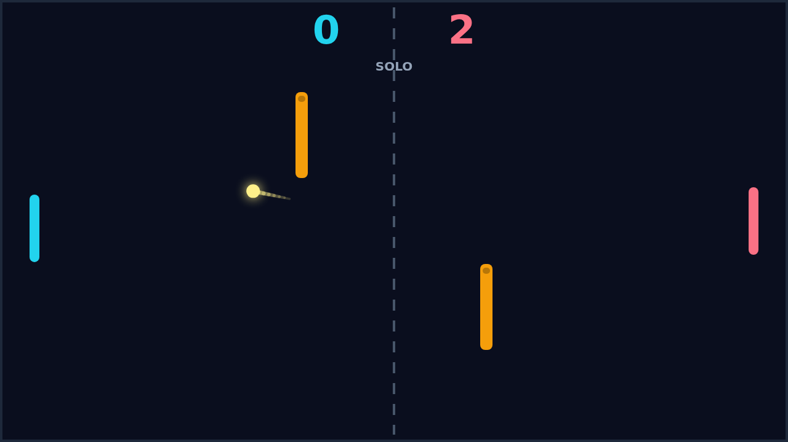
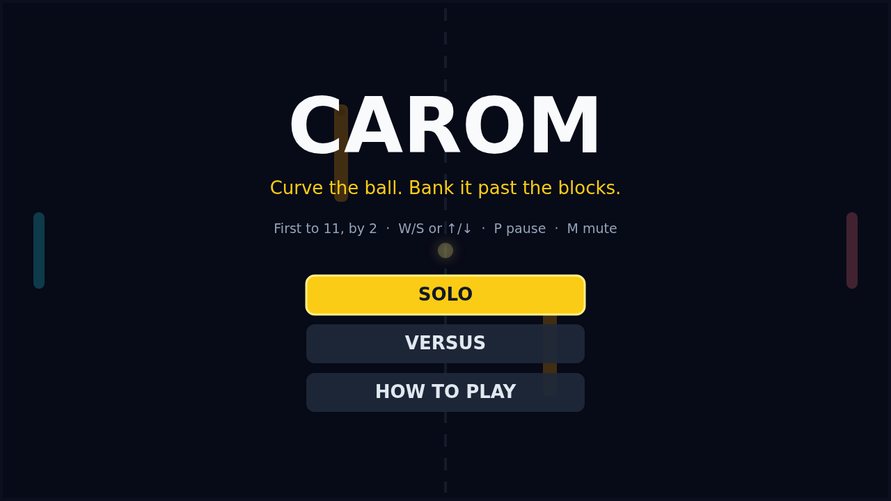

Carom is a top-down paddle duel for the browser: two paddles face off across a dark field, and a glowing ball ricochets between them at ever-rising speed. The first serve is gentle, but every paddle hit makes the ball faster, and the first player to let it slip past their edge concedes the point. Matches go to 11 points and must be won by two, so a rally at 10–10 can run long — and get very fast.

What makes Carom its own game is spin. Strike the ball while your paddle is moving and you bend its flight: drive upward through the contact and the ball curls up, drag downward and it dives, with the curve fading over the next second or so. A good player doesn't just return the ball — they shape it, spinning shots around the far paddle or making a safe-looking return swerve late and wrong-foot the guard.

Two amber blocks sit fixed in midfield and turn the open table into a bank-shot puzzle. Bounce the ball off a block, off a wall, add a little spin, and it arrives from an angle nobody was covering. The blocks also break up lazy straight-line rallies: the obvious shot is often the one that clips a corner and comes back at you.

Play Solo against an AI that tracks incoming balls and drifts home when play goes the other way, or grab a second player for Versus on one shared keyboard — W/S on the left, arrows on the right. Either way it's a short, sharp duel: curve the ball, bank it past the blocks, and don't blink at match point.

